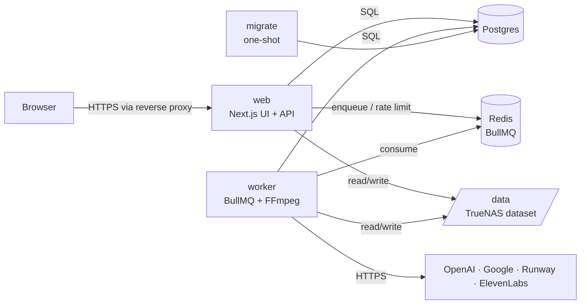
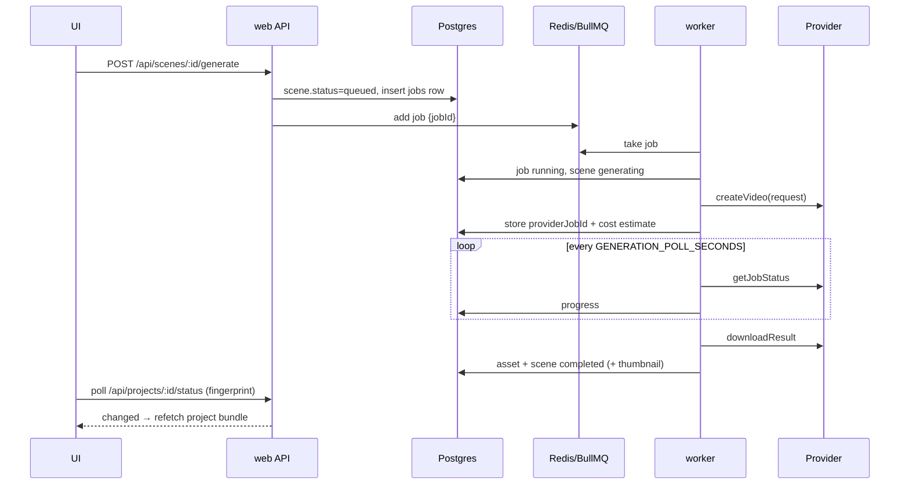

# Architecture

## Services



- **web** (`apps/web`, Next.js 15 App Router, standalone output) serves the UI and a JSON REST API under `/api/*`.
  - Route handlers authenticate, validate input with zod, stream uploads to `/data`, create DB rows and enqueue jobs.
  - It never waits for long-running work.
  - Only the Settings "test connection" and voice-sample endpoints call providers directly.
- **worker** (`apps/worker`) runs BullMQ consumers for five queues: `analysis`, `llm`, `generation`, `voiceover` and `render`.
  - Its image includes FFmpeg/ffprobe, fontconfig with the caption fonts, and poppler (`pdftotext`).
  - It writes a heartbeat (including the FFmpeg version) to Redis every 15 seconds.
  - It exposes `:3001/health`.
- **migrate** (worker image) applies Drizzle SQL migrations, creates the storage layout and bootstraps the admin account. It then exits; web and worker start only after it succeeds.
- **packages/core** holds everything shared:
  - config validation, DB schema, queues, storage and security helpers;
  - provider adapters, FFmpeg builders, caption and timeline logic;
  - the job handlers themselves.

  The worker bundles it with tsup; Next transpiles it.

## Data model (Postgres)

`users`, `sessions`, `projects` (form details plus JSON voice, audio, caption and branding settings, and the brief), `references`, `scenes`, `assets`, `jobs`, `renders`, `brands`, `app_settings` (defaults and encrypted API keys).

**Postgres is the source of truth for job state.** Every queued task has a `jobs` row that records:

- `status` (`queued | running | completed | failed | cancelled`), progress, attempts and error;
- the provider and its job ID, cost estimate and usage;
- the BullMQ job ID.

Scene statuses (`draft | queued | generating | completed | failed | cancelled`) mirror their generation job.

## Job lifecycle



- **Retries:** `runTracked()` (`packages/core/src/jobs/context.ts`) classifies errors.
  - Provider and network errors marked retryable go back to `queued`, and BullMQ retries them with exponential backoff.
  - Validation errors, auth errors, provider-side generation failures, and the final attempt mark the job `failed` and run a failure hook (for example, the scene becomes `failed` with the message).
- **Cancellation:** cancelling marks the job `cancelled` and removes it from the queue if it is still waiting. A running handler notices within about 3 seconds through an `AbortSignal`, cancels the provider task if the provider supports it, and FFmpeg processes are killed.
- **Progress:** the UI polls `/api/projects/:id/status` every 2 seconds while jobs are active (8 seconds when idle). It returns a hash of all job, scene, reference and render states, and the UI refetches the full bundle only when that hash changes.

## Reliability

- **State is persistent.**
  - Postgres keeps projects, storyboards, jobs and asset metadata.
  - Redis keeps queues, using an append-only file with `appendfsync everysec`.
  - Media lives on the dataset.
- **Worker crash or restart:**
  - Active BullMQ jobs whose lock expires are detected as stalled and re-run, up to 3 times.
  - Generation handlers resume polling the stored `providerJobId` instead of resubmitting, so no duplicate spend.
- **On startup, `recoverJobs()` reconciles Postgres with Redis:**
  - Jobs Redis no longer knows about are handled by type:
    - generation jobs with a provider job ID are re-queued in **resume** mode;
    - queued jobs and LLM jobs are re-queued;
    - other interrupted jobs (renders, analysis) are marked `failed` ("Interrupted by a restart") so the user can retry.
  - Stale temp directories (older than 12 hours) are removed.
- **Graceful shutdown:** SIGTERM lets active jobs finish, with a 25-second grace period.
- **Retry from the UI:** `requeueJob()` gives the job a fresh BullMQ ID and resets the scene, render or reference state.

## Provider abstraction

`packages/core/src/providers/video/types.ts`:

```ts
interface VideoProvider {
  capabilities(): ProviderCapabilities; // durations, aspect ratios, image support
  createVideo(req: VideoGenerationRequest): Promise<VideoJob>;
  getJobStatus(jobId: string): Promise<VideoJobStatus>;
  downloadResult(jobId: string): Promise<GeneratedVideo>;
  cancelJob?(jobId: string): Promise<void>;
  testConnection?(): Promise<{ ok: boolean; message: string }>;
}
```

- **Implementations:**
  - `GoogleVideoProvider`: two instances, `google` (Gemini Omni Flash) and `veo` (Veo 3.1).
  - `RunwayProvider`.
  - `MockVideoProvider`: FFmpeg test pattern. The job ID encodes the request, so it survives restarts; the marker `[mock-fail]` forces a failure.
- **Mapping:** each adapter converts the common request into its own format: the nearest supported duration, the closest supported aspect ratio with a crop later, and an optional reference image.
- **Registry:** `providers/registry.ts` builds adapters from env and settings keys; `MOCK_PROVIDERS=true` swaps in mocks everywhere.
- **Other clients:**
  - `OpenAIClient` (Responses API with strict JSON Schema generated from zod, then re-validated with zod).
  - `ElevenLabsClient` (TTS with timestamps).
  - Both have mocks.
- **HTTP:** all calls go through `providerFetch()`: timeout, retries with exponential backoff and jitter, `Retry-After`, friendly and redacted errors.

## Brand design system

- **Stored with the brand:** brands keep a `designSystem` JSON document (validated by `designSystemSchema`) and a `designStatus` (`none | generating | draft | approved`). Brand assets are `assets` rows with a `brandId` and a `meta.role`: `logo-primary`, `logo-icon`, `logo-light`, `logo-dark`, `product`, `mood`, `guideline` or `other`.
- **Generation:** the `brand` job (`jobs/brand.ts`) thumbnails up to 8 images, measures their dominant colours and extracts text from guideline documents. It sends all of this to the vision model with a strict JSON schema; `normalizeDesignSystem()` repairs hex codes and fonts before the result is stored as a draft.
- **Syncing:** saving a design system syncs the core brand tokens (primary, secondary and accent colours; heading and body fonts) used by overlays and cards.
- **Where it's used:**
  - `buildBrandGuide()` renders the brand and its design system as text for the brief, storyboard and prompt-rewrite requests.
  - `applyBrandToPrompt()` appends the style keywords to every video prompt (within the provider's limit) and builds the negative prompt.
  - Generation falls back to a brand product or mood image as the reference image when a scene has none of its own.
  - Selecting a brand on a project sets the caption font and highlight colour.

## Reference analysis

`jobs/analysis.ts`:

- **Video:**
  - ffprobe gives the technical data.
  - FFmpeg scene-change detection (`select='gt(scene,0.3)'` on a 320-pixel-wide proxy) gives the cut times, average shot length and pace.
  - Frames are extracted at shot midpoints and evenly spaced points (up to 8).
  - The palette comes from downscaled frames; EBU R128 loudness gives the energy level.
  - Speech is transcribed.
  - The frames plus metrics go to the vision model, which returns structured style fields: camera, framing, lighting, colour, transitions, caption placement, typography, effects, music energy, hook, ending/CTA.
- **Images:** palette and vision analysis.
- **Audio:** loudness, plus a transcript for non-music.
- **Documents:** text extraction (`pdftotext` for PDFs).
- **Links:**
  - Only public oEmbed or OpenGraph metadata and the thumbnail are fetched, through the SSRF-safe fetcher.
  - Direct video-file URLs are downloaded, with a size cap, and analysed like uploads.
  - Platform pages are never scraped and no protection is bypassed; the UI asks for the file to be uploaded.
- **Prompts** tell the model to treat references as inspiration only and never to reproduce copyrighted material.

## Rendering pipeline

`ffmpeg/render.ts`: every invocation uses `spawn()` with an argument array (no shell). Paths used inside filter graphs are generated by the app and checked with `assertFilterSafePath`. User text only ever reaches FFmpeg through files: `textfile=` for drawtext and ASS subtitle files.

1. **Validate** each clip with ffprobe.
2. **Normalise** each scene to a segment: scale plus centre-crop to the target size, `fps=30`, `yuv420p`, `tpad` to extend or `trim` to shorten to the exact scene length, and stereo 48 kHz audio (original clip audio at the chosen volume, or silence).
3. **Cards:** intro and outro cards from the brand, using drawtext with the brand font resolved via fontconfig, plus the logo and fades.
4. **Compose** in one filter graph:
   - Join segments with `xfade` / `acrossfade` for transitions, or `concat` for cuts.
   - Burn the ASS file (captions, on-screen headlines, watermark) with libass.
   - Overlay the logo during scenes only.
   - Delay each voiceover to its scene start.
   - Music: loop or trim, fade in and out, and duck under speech with `sidechaincompress`.
   - Sound effects are placed with `adelay`.
   - `amix`, then `loudnorm` to −14 LUFS.
5. **Encode:**
   - Final: `libx264 -profile high -crf 19 -pix_fmt yuv420p -r 30`, AAC 192k at 48 kHz, `-movflags +faststart`.
   - Preview: half resolution, `veryfast`, CRF 28.
6. **Outputs:** the MP4, an SRT and a thumbnail are stored under `exports/` or `previews/`, and a render history row is written. Progress comes from `-progress pipe:1`.

`timeline.ts` computes scene start times, accounting for the intro card and transition overlaps. The same timeline is used for voiceover placement, caption timing and the renderer, so they always agree.

Captions (`captions.ts`) use voiceover word timings (ElevenLabs alignment, or Whisper for uploaded recordings), or spread the script evenly when no timings exist. Words are grouped into short cues. Word-by-word highlighting emits one ASS event per word with colour overrides. Safe-zone margins for TikTok, Reels and Shorts keep captions clear of platform UI.

## Storage

```
/data
  projects/{projectId}/uploads      uploaded replacement clips
                      /references   reference uploads, frames, link thumbnails
                      /generated    provider clips + scene thumbnails
                      /audio        voiceovers, music, SFX
                      /previews     preview renders
                      /exports      final renders + SRT + thumbnails
  brands/{brandId}/                 logos
  temp/                             per-job working directories (always cleaned up)
```

- Stored filenames are random UUIDs; the sanitised original name is kept only in the DB, for downloads.
- All paths are resolved with `safeJoin()`, which rejects `..`, absolute segments and NUL bytes. File serving also checks the real path with `realpath` to rule out symlink escapes.
- Deleting a project removes its folder.

## Security

| Concern       | Implementation                                                                                                                                                                                                        |
| ------------- | --------------------------------------------------------------------------------------------------------------------------------------------------------------------------------------------------------------------- |
| Passwords     | Argon2id (`@node-rs/argon2`: m=19 MiB, t=2, p=1); constant-time dummy verify for unknown emails                                                                                                                       |
| Sessions      | Random 256-bit token in an HttpOnly, SameSite=Lax cookie, Secure when `APP_URL` is https; only its SHA-256 is stored; expiry `SESSION_TTL_DAYS`                                                                       |
| CSRF          | Every state-changing request needs an Origin/Referer in `APP_URL` / `ALLOWED_ORIGINS` **and** a double-submit `x-csrf-token` header                                                                                   |
| Rate limiting | Redis fixed windows: login (per IP+email and per IP), uploads, LLM, generation, render, voice sample, key changes                                                                                                     |
| Uploads       | Streamed with busboy; size limit enforced while streaming; type detected from magic bytes against a per-category allowlist (no SVG/HTML); random stored names                                                         |
| Serving files | Authenticated; `nosniff`; `sandbox` CSP; Markdown served as `text/plain`; Range support                                                                                                                               |
| SSRF          | http/https on ports 80/443 only, no credentials, no local/internal names; DNS answers must be public unicast IPs, checked **at connect time** (defeats DNS rebinding); each redirect re-validated; size and time caps |
| Commands      | FFmpeg, ffprobe, fc-match and pdftotext run via `spawn` with argument arrays; filter paths validated; user text only via files                                                                                        |
| Secrets       | Keys only on the server (env or AES-256-GCM in DB), masked in the UI, redacted from logs and error messages; `server-only` guards keep server modules out of client bundles                                           |
| Headers       | Nonce-based CSP (`script-src 'self' 'nonce-…' 'strict-dynamic'`), `frame-ancestors 'none'`, `X-Frame-Options: DENY`, `nosniff`, Referrer-Policy, Permissions-Policy, COOP                                             |
| Containers    | Non-root (568), `cap_drop: ALL`, `no-new-privileges`, not privileged, resource limits                                                                                                                                 |
| LAN mode      | `AUTH_ENABLED=false` disables login (a warning banner shows in the UI)                                                                                                                                                |
